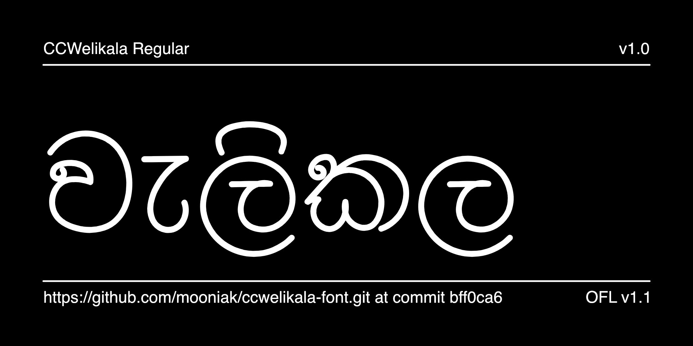
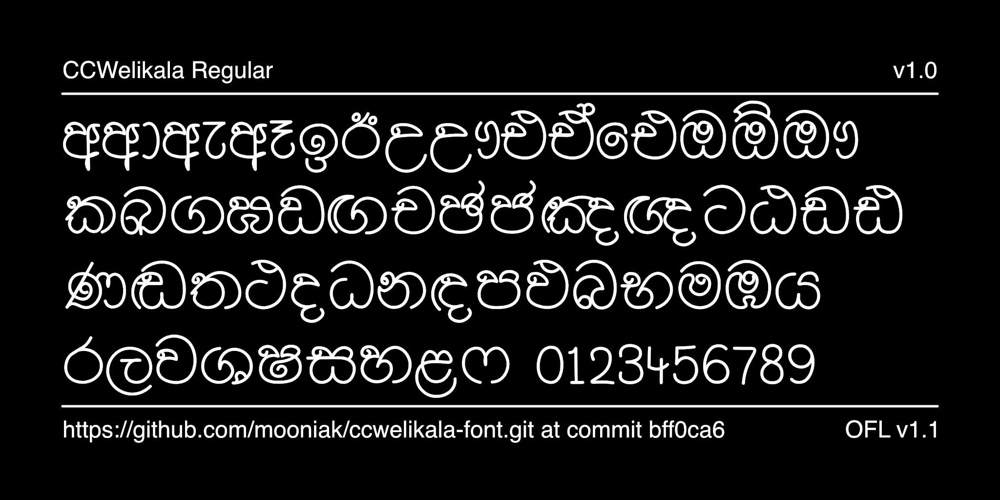

CCWelikala
==========

[![Build][badge-build]][link-build]
[![Fontspector QA][badge-qa]][link-qa]
[![Release][badge-release]][link-release]
[![License: OFL 1.1][badge-license]][link-license]

[badge-build]: https://github.com/mooniak/ccwelikala-font/actions/workflows/build.yaml/badge.svg?branch=dev
[badge-qa]: https://img.shields.io/badge/dynamic/json?url=https%3A%2F%2Fsrc.mooniak.com%2Fccwelikala-font%2Fbuild.json&query=%24.qa.pass_rate&suffix=%25&label=fontspector%20QA%20(dev%20build)&color=informational
[badge-release]: https://img.shields.io/github/v/release/mooniak/ccwelikala-font?label=release
[badge-license]: https://img.shields.io/badge/license-OFL--1.1-green
[link-build]: https://github.com/mooniak/ccwelikala-font/actions/workflows/build.yaml
[link-qa]: https://src.mooniak.com/ccwelikala-font/reports/fontspector/fontspector-report.html
[link-release]: https://github.com/mooniak/ccwelikala-font/releases
[link-license]: OFL.txt

CCWelikala is a round, monoline Sinhala typeface by Damith Welikala (Ceylon Calligraphy), made in 2019.
Its letters are drawn with one even line and round, open shapes, for headings, posters, packaging and short texts at larger sizes. It is published by [Mooniak](https://mooniak.com/) as a free font under the SIL Open
Font License, in a single Regular weight.




## From an ASCII font to Unicode

CCWelikala was first made in the **FM Abhaya ASCII layout**, the encoding most Sinhala fonts used
before Unicode. Sinhala letters were drawn on Latin keys (`l` was ක, `s` the is-pilla drawn to
overprint the letter before it, `f` the kombuva typed *before* the letter, `á` a precomposed ටි).
Text typed that way only reads as Sinhala in that one font. Search, copy-paste, spell-checking
and screen readers all see Latin gibberish.

In November 2026 the source was ported to Unicode with Mooniak's
[`ascii_to_unicode.py`](https://github.com/mooniak/mooniak-font-tools/tree/main/tools/font-migration):

- every glyph got its Sinhala code point or a [LankaGlyphset](https://github.com/mooniak/lanka-glyphsets)
  name reached by OpenType rules (the precomposed ටි ඩී ද්‍ර … are ligatures now);
- what FM typed as several keys (ආ = `wd`, ෛ = `ff`, රු = `re` …) is composed from the same drawings;
- the overprinting signs have zero width and mark anchors that put them exactly where the
  original drew them; the kombuva is reordered by the shaper, not typed first.

Every decision is in [`documentation/ascii-unicode-map.tsv`](documentation/ascii-unicode-map.tsv).
Where this font differs from the standard FM layout, it is in
[`documentation/ascii-overrides.tsv`](documentation/ascii-overrides.tsv): `_` is the repaya and `©` a precomposed ර්‍ය, `¶` a second ග.
The port was checked by rendering 1255 texts (every glyph slot, 961 syllables, 124 words of real FM text) in the old ASCII font and, as Unicode, in the new one: 1248 came out the same. The 7 others are expected: ÷ sat on the soft-hyphen slot, which is never drawn; ඞේ ඡේ use the designer's precomposed ඞ් ඡ්; and ර්‍ය is now set with the font's own ර්‍ය instead of ර + yansaya (which one is the default is the designer's call).

**Old documents typed in the ASCII version** can be converted to Unicode text with
[Pandukabhaya](https://github.com/akuruAI/Pandukabhaya) (`pandukabhaya fm_abhaya -i old.txt -o new.txt`).

## Get the font

- **Download:** the [Releases](https://github.com/mooniak/ccwelikala-font/releases) page. A
  pre-release named `canary` is rebuilt from every push to `dev`. It is the latest development
  work and may be broken, so don't use it in production. Its family name ends in `CANARY`, so it
  can be installed next to a release.
- **Proofs and QA:** the latest development build, with type proofs and the full Fontspector
  report, is at [src.mooniak.com/ccwelikala-font](https://src.mooniak.com/ccwelikala-font/).
- **Build it yourself:** see [Building the fonts from source](#building-the-fonts-from-source).

## Font data

| | |
|---|---|
| **Version** | 1.000 |
| **Script** | Sinhala (no Latin letters; digits and basic punctuation only) |
| **Styles** | Regular |
| **Formats** | TTF, OTF and WOFF2 (`CCWelikala-Regular.*`) |
| **Glyphs** | 192 (114 mapped to Unicode code points; the rest are ligatures and alternates used by OpenType features) |
| **Units per em** | 1000 |
| **Vertical metrics** | ascent 920, descent −280, line gap 0 (1.2 em; `hhea`, typo and win; `USE_TYPO_METRICS` on) |
| **File size** | about 335 KB (TTF), 221 KB (OTF), 128 KB (WOFF2) |
| **Source format** | [Glyphs](https://glyphsapp.com/) 3 package (`sources/CCWelikala.glyphspackage`) |
| **License** | [SIL Open Font License 1.1](OFL.txt) |

### Character coverage

| Range | Encoded |
|---|---|
| Sinhala (U+0D80–0DFF) | 76 of 91, the repaya and a precomposed ර්‍ය, both drawn by the designer. Not drawn: candrabindu U+0D81, ඏ ඐ U+0D8F–0D90, ෳ U+0DF3, kunddaliya U+0DF4, Lith digits U+0DE6–0DEF |
| Basic Latin | space, digits 0–9 and `! % ( ) * + , - . / : ; = ?` |
| Other | × ÷ – • ⋆ ‘ ’, no-break space, ZWNJ, ZWJ, dotted circle (U+25CC); the Ceylon Calligraphy wordmark on U+E000 and an unidentified sign on U+E001 (private use) |

### OpenType features

The features are generated by `ascii_to_unicode.py` from the glyphs the font has.

| Layout table | Features |
|---|---|
| `GSUB` | `akhn` (ක්‍ෂ) `rphf` (repaya) `vatu` (rakaransaya, yansaya, ද්‍ර) `pstf` (two-part vowels) `abvs` `blws` `psts` (consonant + sign ligatures, ක්‍ව ත්‍ව න්‍ධ, the designer's ර්‍ය, the hook-form ු/ූ after ක ග ත භ ශ, රු රූ) `ss01` (below-base ඳා) |
| `GPOS` | `abvm` `mark` (ි ී ු ූ ් placed where the original drew them) |

Most conjuncts fall back to a letter with a visible al-lakuna, and some glyphs need the designer to confirm what they are.

## Repository structure

| Path | What it is |
|---|---|
| `sources/CCWelikala.glyphspackage` | The font source: glyphs, anchors and OpenType feature code, as a Glyphs 3 package |
| `sources/config.yaml` | Build configuration read by [gftools](https://github.com/googlefonts/gftools) |
| `fontpackage.json` | Mooniak catalogue metadata (name, designer, tier, channels) |
| `Makefile` | Build, test and proof targets (see below) |
| `requirements.in`, `requirements.txt` | Python dependencies: the top-level list, and the pinned set used for builds |
| `fonts/`, `out/`, `_site/` | Build output, QA/proof reports and the proof site (created by `make`; not committed) |
| `documentation/` | Specimen images and their DrawBot scripts, the font description (`ARTICLE.en_us.html`), and the ASCII → Unicode port records (`ascii-unicode-map.tsv`, `ascii-overrides.tsv`) |
| `scripts/` | Helper scripts used by the Makefile and CI (from the Mooniak project template) |
| `OFL.txt`, `AUTHORS.txt`, `CONTRIBUTORS.txt` | License and credits |

## Building the fonts from source

Building needs only free, open-source tools. You need Glyphs only to edit the source, not to build.

### Requirements

- **macOS or Linux** (on Windows, use [WSL](https://learn.microsoft.com/windows/wsl/)).
- **Python 3.12** with `venv` and `pip`, the version CI uses. The dependencies in
  `requirements.txt` are pinned, and other Python versions may fail to install them.
- **Make** and **git**, and network access for the first build.

### Build

```sh
git clone https://github.com/mooniak/ccwelikala-font.git
cd ccwelikala-font
python3.12 -m venv venv
make build
```

`make build` installs the pinned dependencies into `venv/` (first run only), then runs
[`gftools builder`](https://github.com/googlefonts/gftools) on `sources/config.yaml`. Output:

```
fonts/ttf/CCWelikala-Regular.ttf
fonts/otf/CCWelikala-Regular.otf
fonts/webfonts/CCWelikala-Regular.woff2
```

Each rebuild deletes and recreates `fonts/`. `make` doesn't notice edits inside the package
folder, so after editing the source run `rm build.stamp && make build`.

### Quality checks and proofs

These need two extra tools, installed with
[`cargo binstall`](https://github.com/cargo-bins/cargo-binstall):

```sh
cargo binstall fontspector     # for `make test`
cargo binstall diffenator3     # for `make proof`
```

| Command | What it does |
|---|---|
| `make test` | Runs [Fontspector](https://github.com/fonttools/fontspector) with the Google Fonts profile and writes reports to `out/fontspector/`. It doesn't stop on failures; read the report. |
| `make proof` | Runs `diff3proof` and writes an HTML proof to `out/proof/`. |
| `make pages` | Builds the stage-gated proof site into `_site/` (needs `make manifest` first). |
| `make images` | Re-renders `documentation/image1.png` and `image2.png`. |
| `make clean` | Deletes `venv/`. |

Known Fontspector failures, shared by Mooniak's other Sinhala-only fonts: the Google Fonts Latin
coverage, language-shaping and "render own name" checks (the font has no Latin letters), and the
GF repository-layout check.

## Releases and versioning

Versions follow [OpenFV](https://github.com/openfv/openfv) (`MAJOR.MINOR`, three-digit minor).
Work happens on `dev`; `main` only moves when a release is cut.

| You want | Do this | CI publishes |
|---|---|---|
| the latest build | push to `dev` | the rolling `canary` pre-release and the proof site |
| a fixed preview for testers | tag a `dev` commit `vX.YYY-dev.N` | a GitHub pre-release |
| a release | merge `dev` into `main` (no squash), tag `main` `vX.YYY` | a GitHub Release |

Bump `versionMajor`/`versionMinor` in the source before tagging. The next release after the
2019 version 1.000 should be **1.001** or later.

## Contributing

Bug reports and design feedback are welcome in the
[issue tracker](https://github.com/mooniak/ccwelikala-font/issues). Open pull requests against
`dev`, edit `sources/CCWelikala.glyphspackage` with Glyphs 3, rebuild
(`rm build.stamp && make build`) and run `make test`. Add yourself to `CONTRIBUTORS.txt`.

## Credits

- **Design:** Damith Welikala, Ceylon Calligraphy (2019)
- **Unicode port, production and publishing:** [Mooniak](https://mooniak.com/) (2026)
- **FM Abhaya mapping data:** [Pandukabhaya](https://github.com/akuruAI/Pandukabhaya) (MIT)

## Changelog

**18 November 2026, version 1.000 (development)**

- Ported from the FM Abhaya ASCII layout to Unicode: LankaGlyphset names, Sinhala code points,
  composed vowels and ligatures, generated OpenType features, mark anchors.
- Moved to the Mooniak build pipeline: Glyphs 3 package, gftools builds with CI, proofs and QA.
- Added no-break space, ZWJ/ZWNJ and dotted circle; Google Fonts vertical metrics; Mooniak copyright, designer, vendor ID and OFL licence in the font.

**2019, version 1.000.** Damith Welikala's original, an FM-layout ASCII font made in FontForge.

## License

This Font Software is licensed under the SIL Open Font License, Version 1.1. This license is
available with a FAQ at https://openfontlicense.org
